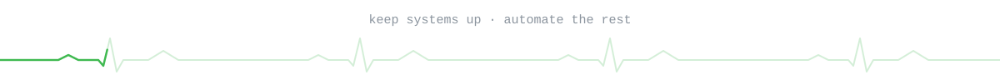

 

  

## About me

I'm Alejandro, an IT Infrastructure Administrator at a 24/7 semi-automated container terminal in Algeciras and a Computer Engineering student at [UOC](https://www.uoc.edu). My day to day is keeping the Terminal Operating System and everything underneath it running around the clock, from IBM Power and Oracle RAC to VMware and hundreds of industrial Cisco switches.

What drives me is keeping critical systems alive and making them run better. When something breaks, my first instinct is to find the fix. When something works but eats up time, I automate it so the team can focus on what matters.

A vessel call, simplified: discharge, then load. Cranes and AGVs work from what the TOS tells them, and every move is reported back to it across two data centers.

Outside the terminal I'm building [nossoa-os](https://nossoa.com), AI software for hotels, and I run its infrastructure myself. It lives on Proxmox and Rocky Linux, with every service deployed in pairs so it can scale out to a second host.

Long term, I want to bring what I've learned about resilient, cloud-native and secure systems to the space sector, helping design and operate the ground and orbital infrastructure behind satellites.

## Impact

## What I do

| Area | Highlights |
| :--- | :--- |
| **High availability** | Redundant designs across multiple data centers for a 24/7 Terminal Operating System |
| **Hybrid cloud** | AWS and Azure: provisioning, networking, identity, governance and cost optimization |
| **Enterprise systems** | IBM Power/AIX (PowerHA/HACMP, HyperSwap, VIOS, NIM), Oracle RAC, VMware vSphere 8, RHEL, Windows Server |
| **Networking** | Cisco Catalyst and industrial switching at scale, with STP and stack designs |
| **Automation** | Maintenance scripts and AI agents that take routine work off the team |

## Tech stack

| Area | Stack |
| :--- | :--- |
| **Cloud** |   |
| **Systems** |        |
| **Data and backup** |    |
| **Networking** |  |
| **Code and delivery** |    |

## Building in public

Coming soon to this profile:

- **container-terminal-digital-twin.** A digital twin of a fully automated container terminal (vessel, STS, AGV, ASC, ARMG, rail) to measure how equipment changes and stoppages affect productivity.
- **ha-infrastructure-lab.** A reproducible high availability lab with failover tests and uptime, RTO and RPO measurements.
- **cisco-network-automation.** Templates and Python tooling to configure and audit industrial switches at scale.

## Certifications and training

40 on LinkedIn. Highlights:

| Area | Highlights |
| :--- | :--- |
| Cloud | AWS Academy Cloud Architecting, AWS Cloud Systems Operations, Azure AZ-900 and AZ-104 (2023) |
| Networking | Cisco CCNA (ITN, SRWE, ENSA), Cisco IoT Security |
| Systems | VMware vSphere 8, Red Hat (RH134, OpenShift DO180), Oracle Cloud Data Management 2023 |
| Agile and security | Scrum Master and Product Owner (Scrum Manager, Authority level), CCSK |
| Languages | Spanish, English (Cambridge B2) |

## Let's talk

I'm open to ideas and collaboration on resilient infrastructure, automation and space-sector ground systems. Reach me on [LinkedIn](https://www.linkedin.com/in/anatera) or at anatera@infrastructure365.com.

